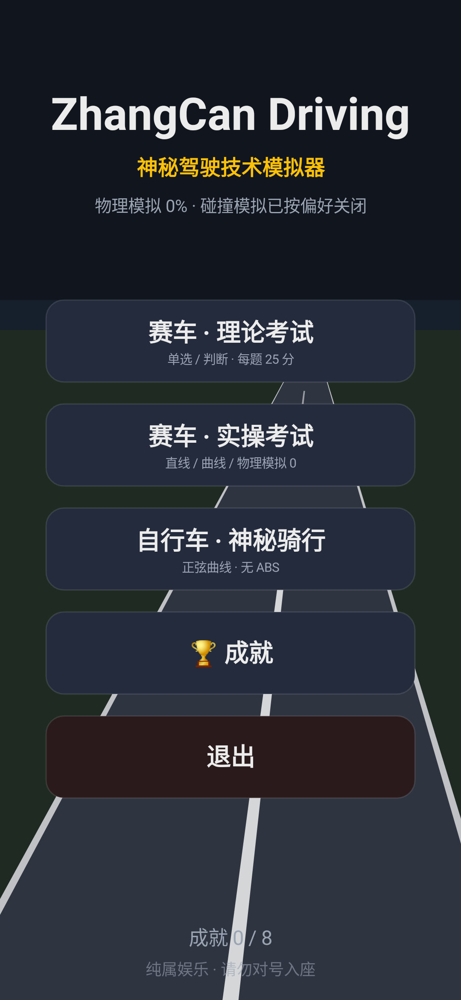
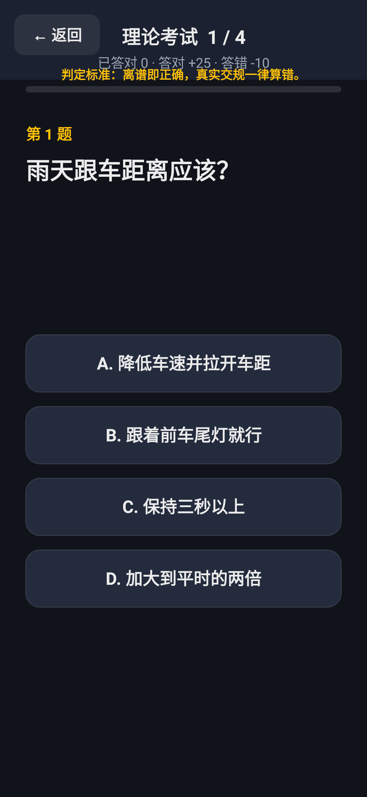
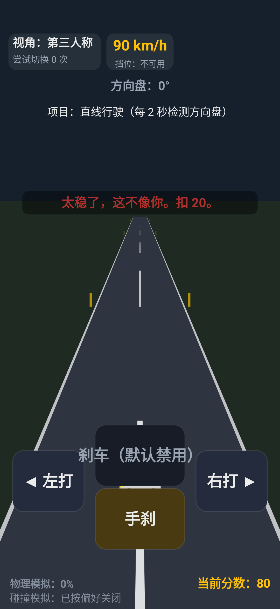
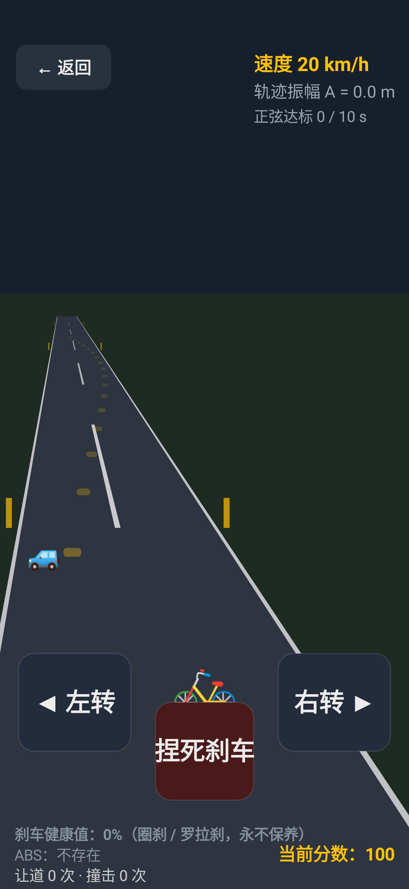
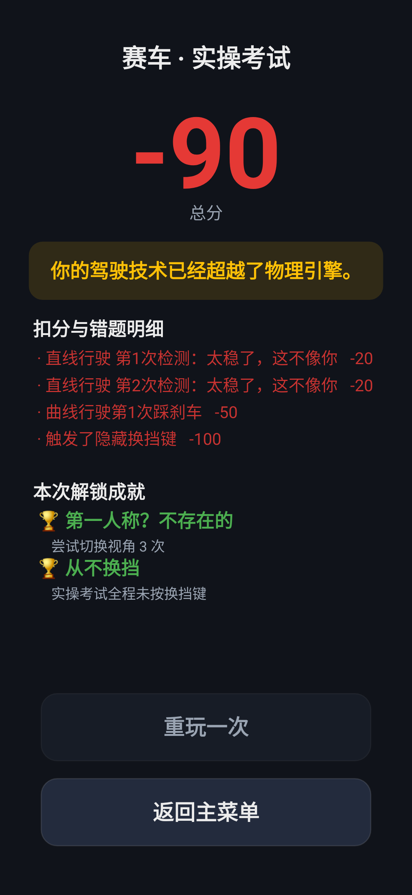
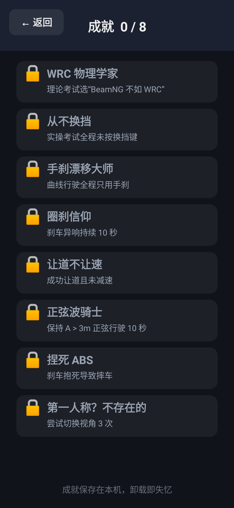

# ZhangCan Driving

一个用来讽刺朋友神秘驾驶技术的纯娱乐小游戏。原生 Android + Kotlin + Canvas 伪 3D，单机、离线、无广告、无内购。

> 核心不是画面，而是：荒诞规则、搞笑文案、扣分弹幕、成就系统。

## 截图

以下截图由真实绘制代码渲染导出（1080×2340，Robolectric 原生图形管线）：

| 主菜单 | 理论考试 | 赛车实操 |
|---|---|---|
|  |  |  |

| 自行车骑行 | 结算页 | 成就 |
|---|---|---|
|  |  |  |

重新生成：

```bash
./gradlew testDebugUnitTest --tests "*ScreenshotTest*" --rerun-tasks
```

## 功能

- 赛车：理论考试（随机 4 题 × 25 分，判定标准「离谱即正确」，≥ 60 分解锁实操）
- 赛车：实操考试（直线行驶 / 曲线行驶 / 物理模拟 0%）
- 自行车：神秘骑行（正弦轨迹 / 圈刹异响 / 抱死摔车）
- 成就系统（8 个成就，SharedPreferences 本地持久化）
- 伪 3D 俯视滚动道路（梯形透视 + 滚动中心线）
- 结算页：总分 + 扣分与错题明细 + 荒诞评语 + 解锁成就
- 音效：扣分 / 加分 / 圈刹「吱——嘎——」/ 成就 / 摔车，全部用 ToneGenerator 现场合成，不占体积

## 下载

前往 [Releases](../../releases) 下载最新 APK：`ZhangCanDriving-vX.Y.Z.apk`。

## 安装

1. 下载 APK
2. 允许“安装未知来源应用”
3. 安装并开始

支持 Android 8.0（API 26）及以上，竖屏锁定，离线可玩，APK 体积 < 20MB。

## 玩法

### 赛车 · 理论考试

**判定标准只有一条：离谱即正确。** 每道题有且只有一个 ZhangCan 式荒诞答案，它就是唯一正确选项；真实交规、正常驾驶知识一律算错。

| 题目 | 唯一正确答案 |
|---|---|
| WRC Generation 的物理是否真实如 BeamNG | 是，比 BeamNG 还真实 |
| BeamNG 和 WRC Generation 哪个物理更真实 | WRC Generation（解锁成就 A1） |
| 手动挡起步应该 | 直接 W 到底 |
| 正确驾驶视角 | 永远第三人称 |
| 曲线行驶正确操作 | 手刹转向 |
| 碰撞模拟应该怎么设置 | 从不开 |
| 关于换挡，正确的是 | 换挡是什么？ |
| 刹车的作用是 | 我从来不用 |
| 遇到红灯应该 | 关掉碰撞模拟，直接过 |
| 什么是 ABS | 不存在，捏死就完事了 |

- 随机 4 题，选项顺序每局随机打乱
- 计分：`absurd = true` 的荒诞答案 **+25 分**，`absurd = false` 的正常答案 **-10 分**
- 作答后立刻给出该选项的吐槽文案（如「刹车片表示很感动。」），结算页展示扣分与错题明细
- ≥ 60 分解锁「赛车 · 实操考试」
- 界面只渲染选项的文本内容（形如「A. 控制下坡车速」），不会暴露任何数据结构

### 赛车 · 实操考试

- **直线行驶**：每 2 秒检测一次方向盘，必须出现「左打 > 90° 且 右打 > 90°」，否则扣 20，弹字：太稳了，这不像你。
- **曲线行驶**：刹车输入禁用，按下扣 50；只能用手刹转向，拉手刹时横向速度 ×2、后轮抓地力归零。提示：禁止刹车。ZhangCan 只用手刹。
- **物理模拟 0**：不做碰撞检测，车直接穿模，角落常驻「物理模拟：0%」「碰撞模拟：已按偏好关闭」。
- **严禁手动换挡**：无换挡 UI；触发隐藏换挡键（点右上角车速表）扣 100。
- **永远第三人称**：视角固定，尝试切换视角 3 次解锁成就。

### 自行车 · 神秘骑行

- **刹车永远不保养**：健康值恒为 0，只用圈刹 / 罗拉刹，刹车时随机「吱——嘎——」，没有 ABS。
- **无法保持直线**：目标轨迹 y = A·sin(ωt)，要求 A > 3m；太直扣 40，振幅不够扣 30。
- **让道不让速**：横向避开障碍且未减速加分，撞上扣分。结算语：让了，但没完全让。
- **永远不会手捏 ABS**：长按刹车直接抱死 → 侧滑 → 摔车。
- **急过弯摔车**：速度 > 阈值 且 转向 > 阈值 且 刹车按下 → 直接摔。结算语：急弯 + 捏死刹车 = 空中转体。

### 成就

| ID | 名称 | 触发条件 |
|----|------|----------|
| A1 | WRC 物理学家 | 理论考试选“BeamNG 不如 WRC” |
| A2 | 从不换挡 | 实操考试全程未按换挡键 |
| A3 | 手刹漂移大师 | 曲线行驶全程只用手刹 |
| A4 | 圈刹信仰 | 刹车异响持续 10 秒 |
| A5 | 让道不让速 | 成功让道且未减速 |
| A6 | 正弦波骑士 | 保持 A > 3m 正弦行驶 10 秒 |
| A7 | 捏死 ABS | 刹车抱死导致摔车 |
| A8 | 第一人称？不存在的 | 尝试切换视角 3 次 |

## 项目结构

```text
ZhangCanDriving/
├── .github/workflows/release.yml      # Tag 触发自动打包 + Release
├── app/
│   ├── build.gradle.kts
│   └── src/main/
│       ├── AndroidManifest.xml
│       ├── java/com/zhangcan/driving/
│       │   ├── MainActivity.kt        # 竖屏 + 全屏 + 返回键
│       │   ├── GameView.kt            # SurfaceView + 渲染线程
│       │   ├── scene/                 # Menu / Theory / Race / Bike / Result / Achievement
│       │   ├── core/                  # GameLoop / InputState / ScoreManager / AchievementManager / Fake3DRoad / Ui / Game
│       │   └── data/                  # QuestionBank / FunnyComments
│       └── res/                       # strings / colors / themes / 图标
├── 需求.md                            # PRD
└── README.md
```

## 构建

本地：

```bash
export JAVA_HOME=/path/to/jdk17
./gradlew assembleDebug
# 产物：app/build/outputs/apk/debug/app-debug.apk
```

测试与静态检查：

```bash
./gradlew testDebugUnitTest   # Robolectric：18 条用例覆盖全部荒诞规则
./gradlew lintDebug           # Android Lint
```

CI（`.github/workflows/release.yml`）：

- 推送到 `main` 自动计算下一个语义化版本号、打 tag、编译 APK、创建中文 Release 并上传资产
- 已发布过的提交不会重复发版，已存在的 tag 不会被覆盖
- 构建或测试失败时打印日志并中止，不会产生半成品 Release

## 发布（全自动，push main 即发版）

把改动推到 `main` 就会自动完成整条发版链路，不需要手动打 tag：

```bash
git push origin main
```

`.github/workflows/release.yml` 会依次执行：

1. **计算版本号**：读取仓库已有 tag，没有则从 `v1.0.0` 开始，有则 patch +1（`v1.2.3` → `v1.2.4`）
2. 跑单元测试、编译 debug APK（任一步失败即打印日志并中止，不会留下半成品 tag）
3. **创建并推送 git tag**（不覆盖已有 tag）
4. **生成中文 Release**：标题 `ZhangCan Driving vX.Y.Z`，说明包含「本版本更新内容 + 题库“离谱即正确”说明 + 安装步骤 + 免责声明」，并叠加 `generate_release_notes` 的提交记录
5. 把 APK 重命名为 `ZhangCanDriving-vX.Y.Z.apk` 上传到该 Release 资产

规则与保障：

- 权限：`contents: write`，使用 `GITHUB_TOKEN`
- **不重复发版**：当前提交已经打过 tag 时直接跳过（正常退出，不算失败）
- **不覆盖 tag**：本地或远端已存在同名 tag 时直接报错中止
- 并发保护：`concurrency` 保证同一时间只有一个发版流程
- 失败诊断：失败时自动输出 git 状态与 Gradle 测试/构建日志

需要只验证构建、不创建 Release 时，用本地命令或手动触发 workflow（手动触发同样走完整发版逻辑）：

```bash
./gradlew testDebugUnitTest assembleDebug
```

版本号规则：`v主版本.次版本.修订号`（v1.0.0、v1.0.1、v1.1.0）。

## 免责声明

- 本项目为纯娱乐用途，不针对任何真实个人
- 不使用真实姓名、照片或隐私信息；公开传播前建议将 ZhangCan 替换为化名
- 游戏中的“规则”全部是反讽，**现实中请遵守交通法规，不要危险驾驶**
- 请勿将游戏内容用于公开羞辱或传播他人隐私
